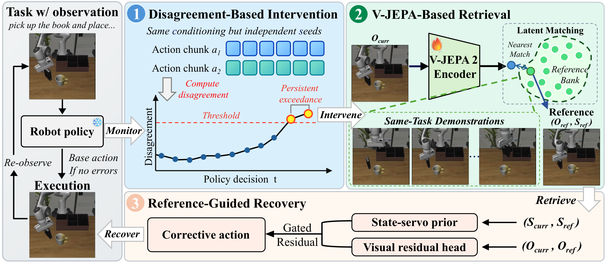
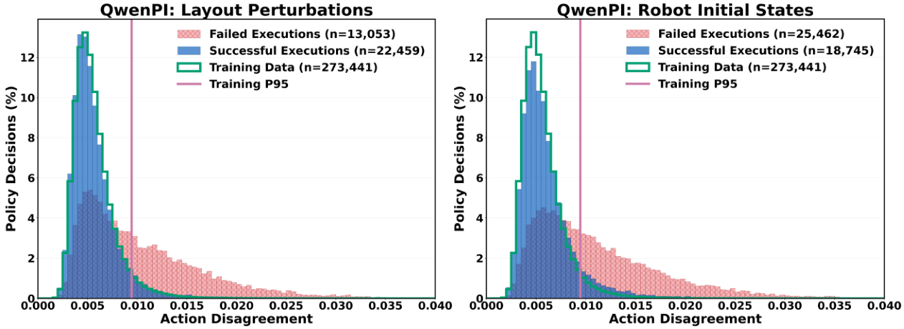

<h1 align="center">🤖 RESETTLE<br>Robotic Recovery through Disagreement-Triggered Retrieval and Efficient Corrective Control</h1>

<p align="center">
  <strong>
    Yuxin Chen &nbsp;&middot;&nbsp; Senqiao Yang &nbsp;&middot;&nbsp; Zixuan Wang &nbsp;&middot;&nbsp; Jinhui Ye &nbsp;&middot;&nbsp; Changsheng Lu<br>
    Pengguang Chen &nbsp;&middot;&nbsp; Shu Liu &nbsp;&middot;&nbsp; Zhuotao Tian &nbsp;&middot;&nbsp; Jiaya Jia
  </strong>
</p>

<p align="center">
  <a href="https://arxiv.org/pdf/2610.12185"></a>
  <a href="https://resettle-robotics.github.io/"></a>
</p>

<p align="center">
  <a href="#overview">✨ Overview</a> &nbsp;&middot;&nbsp;
  <a href="#demo">🎬 Demo</a> &nbsp;&middot;&nbsp;
  <a href="#method">🧩 Method</a> &nbsp;&middot;&nbsp;
  <a href="#getting-started">🚀 Getting Started</a> &nbsp;&middot;&nbsp;
  <a href="#documentation">📚 Docs</a> &nbsp;&middot;&nbsp;
  <a href="#citation">📝 Citation</a>
</p>

<a id="demo"></a>

## 🎬 Demo

https://github.com/user-attachments/assets/195cb46d-e280-44ca-8fac-e4bbd69da30f

<p align="center">
  <a href="https://github.com/JIA-Lab-research/RESETTLE/raw/refs/heads/main/assets/RESETTLE_demo.mp4"></a>
</p>

<a id="overview"></a>

## ✨ Overview

**RESETTLE** is a **model-agnostic recovery framework for frozen robot policies**. It detects persistent disagreement between independently sampled action proposals, retrieves a same-task demonstration reference, and executes **one corrective action** before returning control to the base policy. See the [**paper**](https://arxiv.org/pdf/2610.12185) for the full method and experiments.

- **🔍 Detect emerging deviations.** Monitor two base-policy action proposals under identical conditioning and intervene when calibrated disagreement persists across decisions.
- **🗃️ Retrieve a useful reference.** Use an adapted V-JEPA encoder to find a same-task demonstration and guide correction with its image and state.
- **⚡ Correct and resume.** Combine a state-servo prior with a guarded visual residual, without online trajectory optimization or additional vision-language reasoning.

> [!NOTE]
> **This release covers LIBERO:** joint model training, expert goal-bank encoding, an HTTP recovery service, and a guarded executor example for single-tick (`K=1`) recovery.

<a id="method"></a>

## 🧩 Method

<p align="center">
  
</p>

**Detect → Retrieve → Correct.** Two independently sampled **base-policy** action chunks under identical conditioning are compared at successive decisions. Persistent, calibrated disagreement triggers **same-task demonstration retrieval**. The retrieved image and state guide a state-servo prior and visual correction for **one native action**, after which the base policy resumes. This repository covers the **LIBERO training, expert bank, and recovery server** shown on the right.

### 📈 Why Action Disagreement?

<p align="center">
  
</p>

*Paper motivation: QwenPI on LIBERO-Plus.* The plotted training-data **P95** and heavier failure tails motivate a **two-consecutive-decision trigger**. This is a paper result, not a threshold estimated by this package. The [two-seed example](docs/TWO_SEED_DISAGREEMENT.md) samples the **recovery head** twice at one fixed observation to inspect residual variance; those samples must not replace the paper's base-policy proposals or temporal trigger.

<a id="repository-structure"></a>

## 🗂️ Repository Structure

```text
RESETTLE/
├── app/                  # Training, goal-bank, and recovery-server entry points
├── src/                  # Shared models, data transforms, and training utilities
│   └── recovery/         # Recovery models, LIBERO helpers, and guarded executor
├── scripts/              # Train / build-bank / serve launchers
├── examples/             # Two-seed recovery-head sampling example
├── configs/              # LIBERO training and recovery configuration
├── docs/                 # HTTP API, runtime contract, and integration guides
├── tests/                # CPU regression and entry-point checks
└── assets/               # Method figures and the original demo video
```

| Start here | Entry point | Implementation |
| --- | --- | --- |
| **Train the recovery model** | [`scripts/train.sh`](scripts/train.sh) | [`app/vjepa_intent_action/`](app/vjepa_intent_action/) |
| **Encode expert goals** | [`scripts/build_bank.sh`](scripts/build_bank.sh) | [`app/build_bank.py`](app/build_bank.py) |
| **Launch recovery inference** | [`scripts/serve.sh`](scripts/serve.sh) | [`app/recovery_server.py`](app/recovery_server.py) |
| **Integrate guarded execution** | [Executor guide](docs/GUARDED_EXECUTOR.md) | [`src/recovery/guarded_executor.py`](src/recovery/guarded_executor.py) |

<a id="getting-started"></a>

## 🚀 Getting Started

Run the following commands from the **repository root**. The shell launchers also locate the repository correctly when invoked by absolute path from another directory; use absolute paths for data, checkpoints, and outputs.

### 🛠️ Environment and Data

Use **Python 3.12** and a **CUDA-capable PyTorch** environment, then install the dependencies:

```bash
python -m pip install -r requirements.txt
```

ViT-G needs substantial GPU memory. The entry points use the following GPU counts:

| Training (default) | Expert-bank encoding | Recovery inference |
| :---: | :---: | :---: |
| **8 GPUs** | **4 GPUs** | **1 GPU** |

Supply a compatible **V-JEPA2-AC ViT-G initial checkpoint** and the four **LIBERO LeRobot expert suites** beneath one directory:

```text
/path/to/libero/
├── libero_object_no_noops_1.0.0_lerobot/
├── libero_goal_no_noops_1.0.0_lerobot/
├── libero_spatial_no_noops_1.0.0_lerobot/
└── libero_10_no_noops_1.0.0_lerobot/
```

Each suite must contain `meta/`, `data/`, and `videos/`. **Models and datasets must be supplied separately**; the package does not download them.

### 1. 🏋️ Train

```bash
export PYTHON=/path/to/python
export LIBERO_DATA_ROOT=/path/to/libero
export VJEPA_PRETRAIN=/path/to/vjepa2-ac-vitg.pt
export RESETTLE_OUTPUT=/path/to/new_output_directory
export NUM_GPUS=8
bash scripts/train.sh
```

Training writes **`latest.pt`** and **`params-pretrain.yaml`** under `RESETTLE_OUTPUT`; start in an **empty output directory**. The context encoder, predictor, and residual head are trained jointly.

<details>
<summary><strong>⚙️ Training configuration details</strong></summary>

[configs/libero.yaml](configs/libero.yaml) specifies four suites, 8 frames at 4 FPS, 256px, a goal at frame 4, `K=1`, `guarded_native_steps=5`, the Gaussian residual head, and joint context-encoder/predictor training with dynamics, native-action, gate, and saturation losses. [scripts/train.sh](scripts/train.sh) fills a temporary YAML with the environment's absolute data/weight/output paths. This is not policy-only fine-tuning.

</details>

### 2. 🗃️ Encode Expert Goals

Use the **trained `latest.pt`** for both the bank and the server. The four-GPU entry assigns one suite per GPU, writes shards, merges them, and requires **40 task IDs**.

```bash
export RESETTLE_CHECKPOINT="$RESETTLE_OUTPUT/latest.pt"
export RESETTLE_BANK=/path/to/new_bank_directory
export BANK_BATCH_SIZE=16
bash scripts/build_bank.sh
```

The output contains `success_id_bank.npz` (`features [N,D]`, `states [N,7]`), `success_id_bank.jsonl`, and `success_id_bank_summary.json`. Expert video paths in JSONL remain external and must still exist when the server retrieves a goal.

### 3. 🌐 Start the Recovery Server

```bash
bash scripts/serve.sh --device cuda:0 --host 127.0.0.1 --port 18082
```

The launcher uses **`RESETTLE_CHECKPOINT`** and **`RESETTLE_BANK`** from the previous step.

| Endpoint | Purpose |
| --- | --- |
| `GET /health` | Check checkpoint/bank metadata and the verified native calibration. |
| `POST /plan-recovery-state-servo-residual` | Retrieve a reference and return a proposed state-servo plus visual-residual correction. |

See the [**HTTP API and runtime contract**](docs/RECOVERY_SERVICE.md) for request/response fields, state conventions, and checkpoint compatibility.

<a id="guarded-native-action"></a>

## 🛡️ Guarded Native Action

The server returns a **proposed action**. The [guarded executor](src/recovery/guarded_executor.py) converts it to a LIBERO native command, applies translation/rotation guards, and preserves the baseline gripper action. Follow the [**integration guide**](docs/GUARDED_EXECUTOR.md) to supply the measured current state, schedule interventions externally, and execute **at most one tick before re-observation**. The example computes an action; it has no robot or simulator connection.

<a id="documentation"></a>

## 📚 Documentation and Examples

| Guide | What it covers |
| --- | --- |
| [**Recovery service**](docs/RECOVERY_SERVICE.md) | HTTP payloads, checkpoint/bank contracts, calibration, and inference limits. |
| [**Guarded executor**](docs/GUARDED_EXECUTOR.md) | Single-tick native conversion, motion guards, and caller responsibilities. |
| [**Two-seed sampling**](docs/TWO_SEED_DISAGREEMENT.md) | Reproducible residual-head sampling and its distinction from the paper's trigger. |

### 🧪 Development Checks

With the project dependencies installed, run the CPU regression suite from the repository root:

```bash
python -m unittest discover -s tests -v
```

These checks cover bank merging, recovery sampling, guarded-action conversion, and entry-point wiring. They do not run training or simulator episodes.

<a id="citation"></a>

## 📝 Citation

If you find **RESETTLE** useful in your research, please cite our [**paper**](https://arxiv.org/abs/2610.12185):

```bibtex
@article{chen2026resettle,
  title={RESETTLE: Robotic Recovery through Disagreement-Triggered Retrieval and Efficient Corrective Control},
  author={Chen, Yuxin and Yang, Senqiao and Wang, Zixuan and Ye, Jinhui and Lu, Changsheng and Chen, Pengguang and Liu, Shu and Tian, Zhuotao and Jia, Jiaya},
  journal={arXiv preprint arXiv:2610.12185},
  year={2026}
}
```
